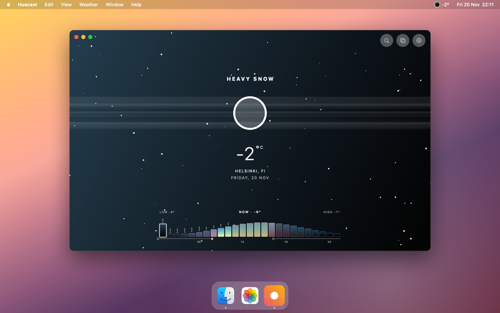
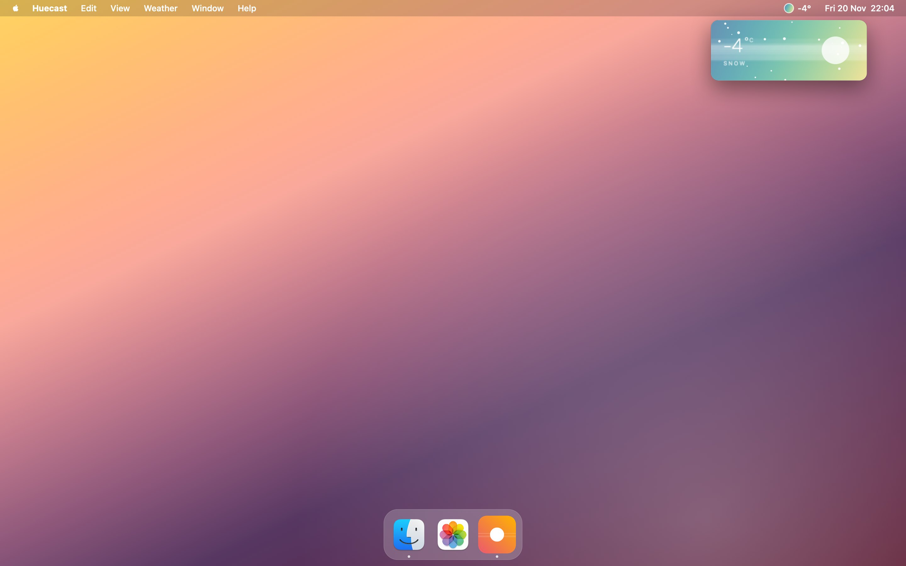
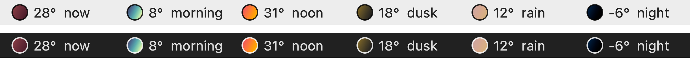

# Huecast for macOS

A native SwiftUI port of [Huecast](https://huecast.app/): one circle, a gradient
made from **temperature × time of day**, and the weather drawn as particles.

**[Download for MacOS](https://github.com/carlosmarch/huecast/releases/latest/download/Huecast.zip)** · macOS 14 or later · Free





The menu bar icon in different skies, on a light and a dark menu bar:



## Build

Needs macOS 14 (Sonoma) or later and Xcode 15+ (or the Command Line Tools).

```sh
cd macos
./build-app.sh            # builds build/Huecast.app
open build/Huecast.app
```

For development, `open Package.swift` in Xcode and run the `Huecast` scheme, or
`swift run` from this folder (location then falls back to your last place or a
random city, since a bare executable can't ask for location permission).

`swift test` checks the sky engine against colours and effects computed by the
web app, so both draw the same sky. The tests also run on Linux.

**Download:** every build of the default branch is published as the latest
[GitHub release](https://github.com/carlosmarch/huecast/releases), and
<https://github.com/carlosmarch/huecast/releases/latest/download/Huecast.zip>
(linked from the landing page) always serves the newest one.

Every push that touches `macos/` builds the app on GitHub Actions
(`.github/workflows/macos.yml`); the zipped `Huecast.app` is attached to the run.
It's ad-hoc signed, so the first time, right click it and choose **Open**.

## What's in it

- The sky: the same palette and OKLCH blending, following the real sunrise and sunset
- Particles in one `Canvas`: stars, cloud bands, fog, rain slanted by the wind,
  snow, wind streaks and thunder flashes, fading from hour to hour
- Sun with pulses and glow by temperature, veiled behind cloud; moon; ice halo below -5°
- Forecast bar: hover to magnify, click or drag to scrub, ← → to step;
  right click (or ⌘D) for the next 7 days
- Search (⌘K or /), random city (⌘R), my location (⌘L), pinned places (⌘P)
- °C / °F (click the temperature), save as picture (⌘S)
- **Use as Desktop Wallpaper** (⇧⌘W): the window becomes a live desktop picture
  below your icons, on every Space. ⇧⌘W again (from the Weather menu) brings it back
- Click the sky to hide the buttons
- **Menu bar:** a full circle painted with the current sky, with a border in
  the menu bar's text colour, and the temperature next to it (can be turned off).
  Click it for a small widget: the temperature, the condition and the sun or moon
  over the live sky. Click the widget to open Huecast full screen. Right click it
  for units, the temperature in the menu bar and Quit. Closing the window keeps
  Huecast in the menu bar

## Keys

The same single keys as the web app, plus ⌘ versions in the **Weather** menu:

| | Key | Menu |
|---|---|---|
| Search | `/` | ⌘K |
| Random city | `R` | ⌘R |
| My location | `L` | ⌘L |
| Next days | `N` | ⌘N |
| Pin this place | `P` | ⌘P |
| Save as picture | `D` | ⌘S |
| Desktop wallpaper | `W` | ⇧⌘W |
| Copy link | `E` | ⌘E |
| °C / °F | `U` | ⌘U |
| Hide the buttons | `H` | |
| Full screen | `F` | ⌃⌘F |
| How it works | `?` | |
| Forecast hours | `←` `→` `Home` `End` | ⌘← ⌘→ |
| Close, leave full screen | `Esc` | |

Launch options (also used by CI for screenshots):
`open Huecast.app --args -lat 40.42 -lon -3.70 -name "Madrid, ES"` opens a fixed place;
`-demo -code 73 -temp -4 -hour 10.5 -name "Helsinki, FI"` shows made-up weather with no
network (a WMO code, °C and the local hour), like the web app's `?demo`;
`-snapshots <dir>` walks through the widget and saves screenshots there.

## Files

```
Package.swift
Sources/HuecastCore/     the sky engine, no UI (builds on Linux too)
  Palette.swift          js/palette.js: colours, OKLCH, sky hour, sun intensity
  Conditions.swift       js/conditions.js: WMO code + amounts -> effects
  Weather.swift          js/weather.js: Open-Meteo, geocoding
  Cities.swift           js/cities.js (generated)
Sources/Huecast/         the app (SwiftUI + AppKit)
  HuecastApp.swift       window, menus, desktop wallpaper mode
  AppModel.swift         state, loading, refresh, pins
  ContentView.swift      the screen
  SkyView.swift          gradient layers
  SceneView.swift        js/scene.js: particles
  SunView.swift          sun, moon, halo, loader
  ForecastBar.swift      the timeline
  Overlays.swift         search, next days
  Picture.swift          save as picture
  MenuBar.swift          menu bar icon and widget
  Snapshots.swift        screenshot mode for CI
  LocationProvider.swift CoreLocation
Support/Info.plist
build-app.sh
```
